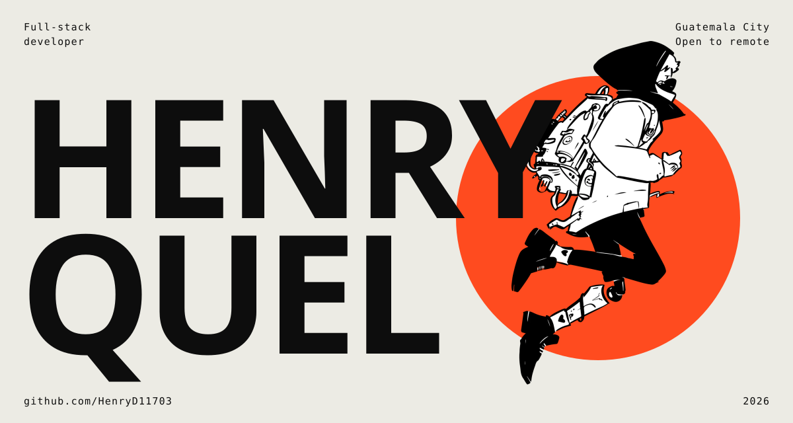
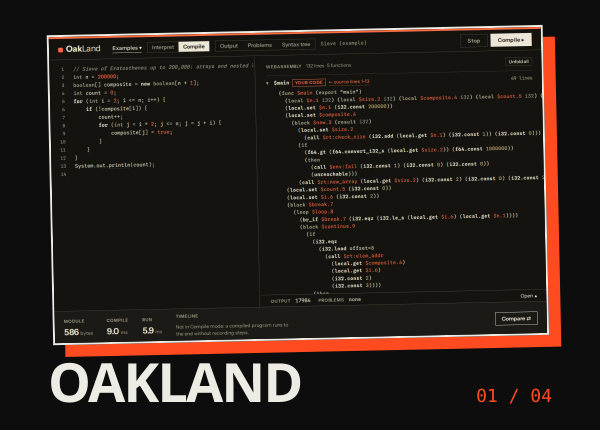
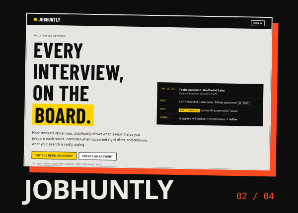
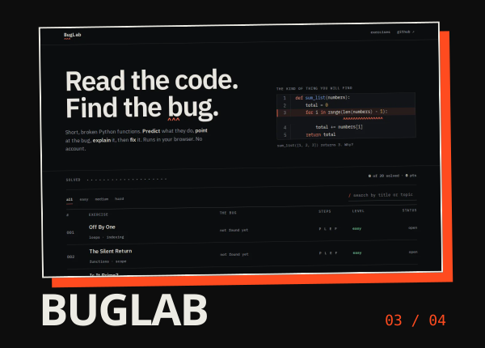
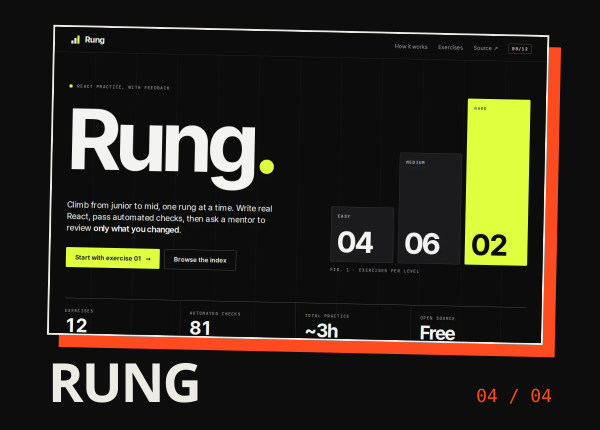

I'm a full-stack developer in Guatemala City. I build complete products with TypeScript, React and Next.js, C# and .NET, and PostgreSQL. I write the spec and the tests before the code, and I publish what I build. Today I build production software for a national pharmacy chain, and I'm looking for a **remote full-stack role**.

## Work

<table>
<tr>
<td width="50%" valign="top">

 <b>OakLand</b>: a small programming language with an interpreter you can step through, a static type checker and a compiler to WebAssembly you can read (own binary encoder, no toolchain). 1,600+ tests; compiled programs ran 18–358× faster in my benchmarks.
 <a href="https://oakland-compiler.vercel.app/">Live</a> · <a href="https://github.com/HenryD11703/oakland-compiler">Source</a> · <a href="https://henryquel.tech/projects/oakland">Case study</a>
</td>
<td width="50%" valign="top">

 <b>JobHuntly</b>: an interview notebook. Prepare each round, write down what happened, and see what your search says. .NET 8 API, PostgreSQL, Next.js; the AI only ever drafts.
 <a href="https://job-huntly-smoky.vercel.app/">Live</a> · <a href="https://github.com/HenryD11703/JobHuntly">Source</a> · <a href="https://henryquel.tech/projects/jobhuntly">Case study</a>
</td>
</tr>
<tr>
<td width="50%" valign="top">

 <b>BugLab</b>: learn to read broken Python. Predict the result, find the bug, explain it, then fix it. Python runs in your browser with Pyodide: no server, no account. 177 unit and 87 end-to-end tests.
 <a href="https://bug-lab.vercel.app/">Live</a> · <a href="https://github.com/HenryD11703/BugLab">Source</a> · <a href="https://henryquel.tech/projects/buglab">Case study</a>
</td>
<td width="50%" valign="top">

 <b>Rung</b>: practice React the way an interviewer asks. Twelve exercises, a real editor in the browser, and feedback you can trust: the code decides pass or fail with 81 automated checks, and the model only explains the result.
 <a href="https://rung-delta.vercel.app/">Live</a> · <a href="https://github.com/HenryD11703/rung">Source</a> · <a href="https://henryquel.tech/projects/rung">Case study</a>
</td>
</tr>
</table>

Also: **[Forge](https://github.com/HenryD11703/Forge)**, a VS Code extension that turns the editor into a place to learn, with guided missions reviewed by AI. It is published but paused: its backend is not running.

## Stack

`TypeScript` · `React` · `Next.js` · `C# / .NET 8` · `PostgreSQL` · `WebAssembly` · `React Native` · `GraphQL` · `Playwright`

## Contact

**[henryquel.tech](https://henryquel.tech)** · [CV (English, PDF)](https://henryquel.tech/Henry-Quel-CV.pdf) · [CV (Español, PDF)](https://henryquel.tech/Henry-Quel-CV-es.pdf) · [LinkedIn](https://www.linkedin.com/in/henry-quel/) · [henryquel011@gmail.com](mailto:henryquel011@gmail.com)

The images above are SVGs made by <a href="tools/build-assets.mjs">a small script</a> (fonts and screenshots included), not by a widget service.
